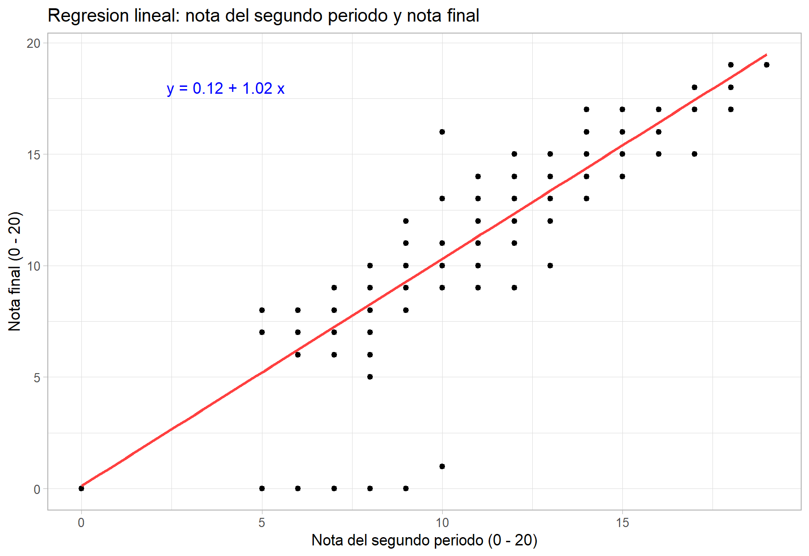
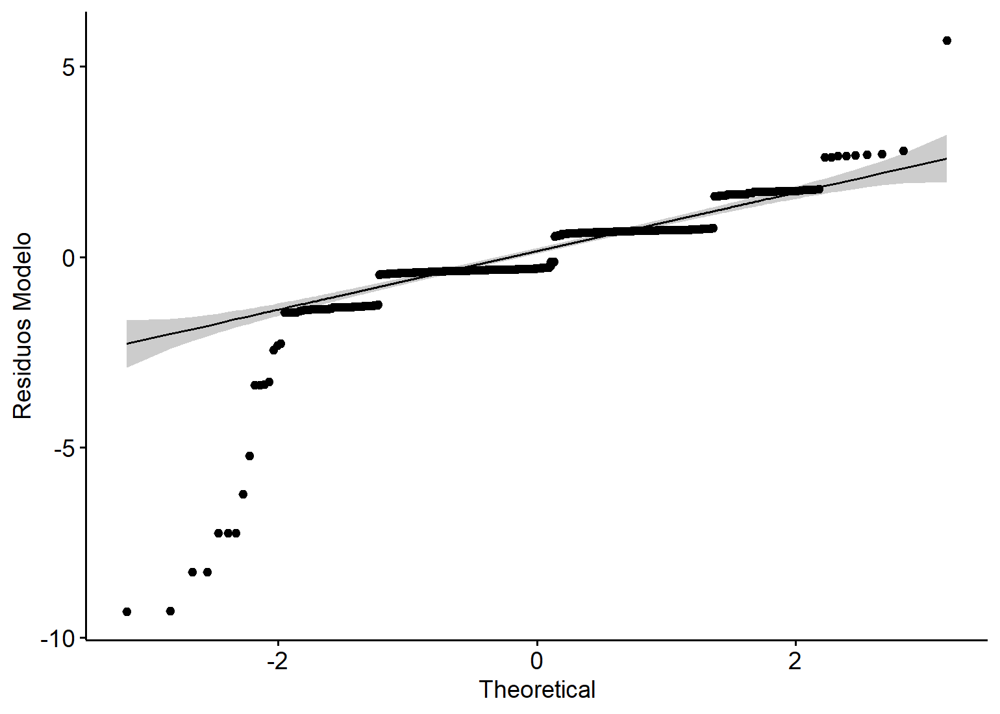
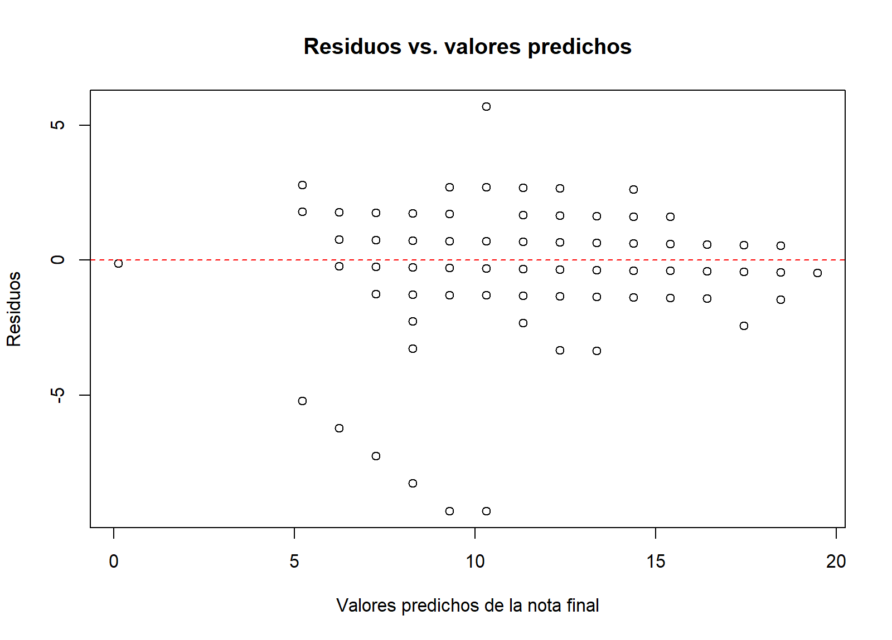
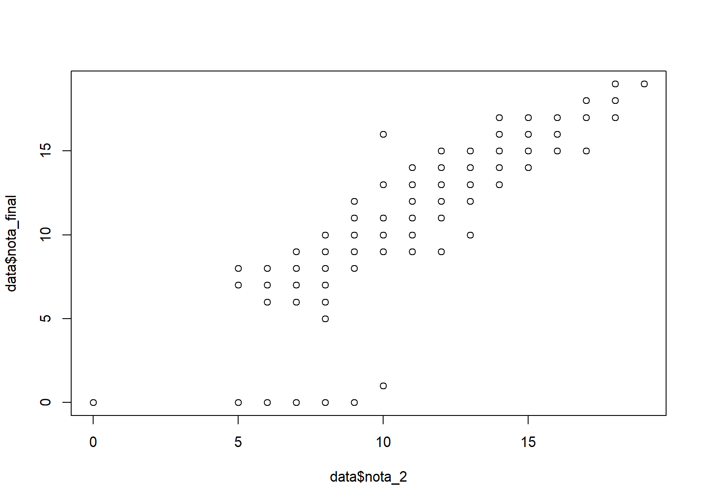
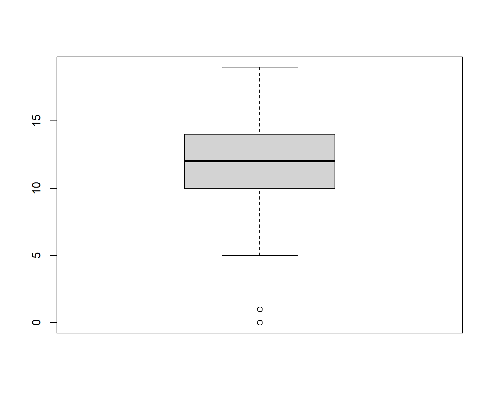
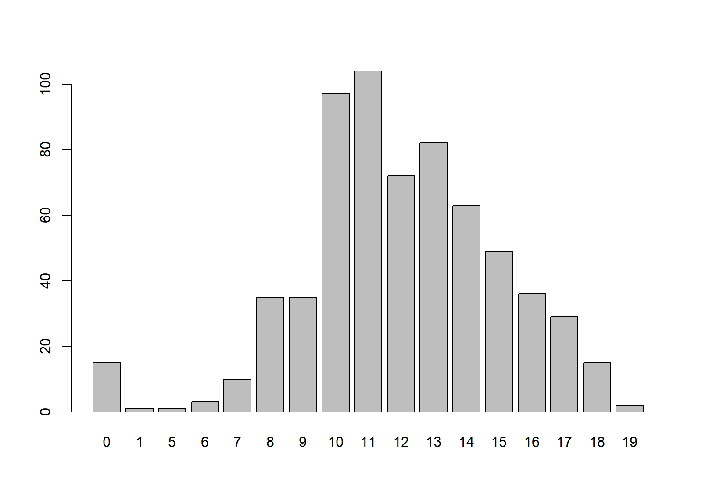

# Regresión Lineal Simple — Rendimiento Estudiantil

Unidad 1, Tema 1 de Modelamiento: introducción al modelado en ciencia de datos. Análisis de regresión lineal simple en R que responde una pregunta concreta: **¿se puede estimar la nota final de un estudiante a partir de la nota que obtuvo en el segundo periodo?**

## Lo solicitado

1. Elegir un conjunto de datos de interés académico.
2. Aplicar un modelo de regresión lineal simple en RStudio con los pasos y métricas vistos en clase: exploración de los datos, correlación de Pearson, ajuste del modelo e interpretación de sus resultados.
3. Verificar los supuestos de la regresión lineal.
4. Entregar el script y un informe con los resultados.

## Datos

[Student Performance](https://archive.ics.uci.edu/dataset/320/student+performance), del UCI Machine Learning Repository: 649 estudiantes de secundaria de dos colegios de Portugal, asignatura de Portugués, 33 variables y sin datos faltantes. Las notas van de 0 a 20. Se usa el archivo original `student-por.csv`; dentro del script, `colnames()` asigna nombres en español a las 33 columnas (por ejemplo, `G2` → `nota_2` y `G3` → `nota_final`).

| Rol | Variable | Descripción |
|---|---|---|
| Independiente (X) | `nota_2` (original `G2`) | Nota del segundo periodo |
| Dependiente (Y) | `nota_final` (original `G3`) | Nota final del año |

## Desarrollo

El script `Guerra_Paul_modelamiento_A.R` sigue el flujo trabajado en clase:

| Paso | Funciones | Qué hace |
|---|---|---|
| Librerías | `ggplot2`, `dplyr`, `ggpubr` | Gráficos y exploración de datos |
| Importación | `read.csv()` | Lee el CSV original |
| Nombres de columnas | `colnames()` | Asigna nombres en español a las 33 columnas |
| Exploración | `glimpse()`, `summary()`, `sum(is.na())` | Estructura, resumen estadístico y datos faltantes |
| Gráficos exploratorios | `plot()`, `boxplot()`, `barplot(table())` | Relación entre variables y valores atípicos |
| Correlación de Pearson | `cor()` | Fuerza y dirección de la relación lineal |
| Modelo | `lm(nota_final ~ nota_2)`, `summary()` | Ajuste de la recta y sus métricas |
| Supuestos | `shapiro.test()`, `ggqqplot()`, residuos vs. predichos | Normalidad y homocedasticidad de los residuos |
| Gráfico final | `ggplot()` + `geom_smooth(method = "lm")` | Recta de regresión con su ecuación |

## Resultados

<p align="center">
  
</p>

```
nota_final = 0.12 + 1.02 × nota_2
```

| Métrica | Valor | Interpretación |
|---|---|---|
| Correlación de Pearson (r) | 0.9185 | Relación lineal positiva muy fuerte |
| Pendiente | 1.0185 (p < 2e-16) | Cada punto más en el segundo periodo se asocia con ≈ 1 punto más en la nota final |
| Intercepto | 0.1220 (p = 0.553) | No significativo: la recta pasa prácticamente por el origen |
| R² | 0.8437 | El modelo explica el 84.4 % de la variación de la nota final |
| Error estándar residual | 1.278 | Las predicciones se alejan en promedio ≈ 1.3 puntos de la nota real |
| Estadístico F | 3493 (p < 2.2e-16) | El modelo es significativo en conjunto |

## Supuestos

| Supuesto | Cómo se revisó | Resultado |
|---|---|---|
| Linealidad | Diagrama de dispersión y correlación de Pearson | Se cumple |
| Normalidad de los residuos | Shapiro-Wilk (W = 0.711, p < 2.2e-16) y gráfico Q-Q | No se cumple |
| Homocedasticidad | Residuos vs. valores predichos | No se cumple completamente |
| Independencia | Cada fila es un estudiante distinto, sin orden temporal | Se cumple |

Los dos supuestos que fallan se explican sobre todo por 15 estudiantes con nota final 0, que probablemente no rindieron la evaluación final y se apartan del patrón general.

| Gráfico Q-Q de los residuos | Residuos vs. valores predichos |
|---|---|
|  |  |

<details>
<summary>Gráficos de exploración</summary>

| Dispersión | Diagrama de caja | Frecuencia de notas finales |
|---|---|---|
|  |  |  |

</details>

## Conclusión

La nota del segundo periodo es un muy buen predictor de la nota final (r = 0.92, R² = 0.84). La pendiente cercana a 1 indica que, en promedio, los estudiantes terminan el año con una nota muy parecida a la del segundo periodo. Como no se cumplen la normalidad ni la homocedasticidad de los residuos, los p-values deben tomarse con precaución. El modelo describe una asociación, no una relación de causa y efecto.

## Ejecución

1. Descargar el repositorio con **Code → Download ZIP** y descomprimirlo.
2. Abrir `regresion-lineal-rendimiento-estudiantil.Rproj` en RStudio.
3. Instalar las librerías si no se tienen (solo la primera vez):
   ```r
   install.packages(c("ggplot2", "dplyr", "ggpubr"))
   ```
4. Abrir `Guerra_Paul_modelamiento_A.R` y ejecutar línea por línea con **Run** (`Ctrl + Enter`).

El CSV está en la misma carpeta que el script, así que no hay que cambiar ninguna ruta.

## Estructura

```
├── Guerra_Paul_modelamiento_A.R                  # Script del análisis
├── student-por.csv                               # Datos originales (UCI)
├── regresion-lineal-rendimiento-estudiantil.Rproj
├── figuras/                                      # Gráficos generados en RStudio
└── README.md
```

## Referencia

Cortez, P. (2008). *Student Performance* [Conjunto de datos]. UCI Machine Learning Repository. https://doi.org/10.24432/C5TG7T

## Autor

Paúl Guerra.

---

Paúl Andrés Guerra Vicuña · Modelamiento · Ingeniería en Ciencia de Datos e Inteligencia Artificial · Universidad Nacional de Chimborazo (UNACH)
